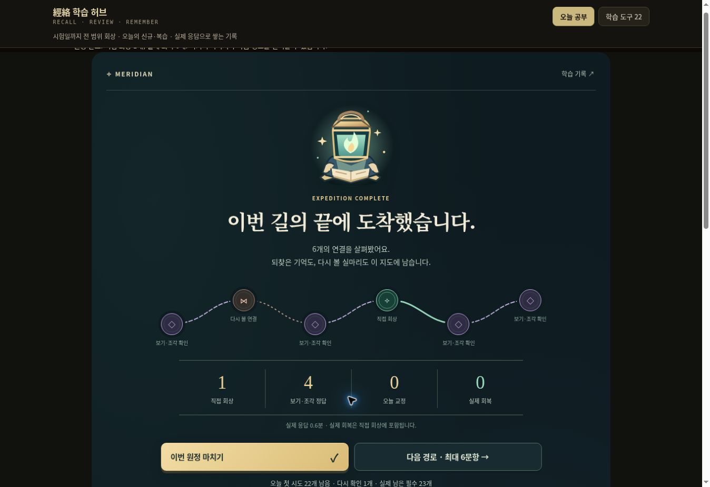

# 경락 허브 · 경락 원정

기존 경락 학습 도구 22개와 원문·음원을 보존하고, 오늘의 학습을 최대 여섯 문항의 모험으로 이어가는 독립 실행 허브입니다. GitHub Pages에서 정적 파일로 실행되며 계정, 서버, ChatGPT 연결 없이 학습할 수 있습니다.

**경락 원정**은 일곱 실주제 구역을 골라 원문 선택지 대결, 유주 순서 퍼즐과 직접 회상을 하는 짧은 게임입니다. 갈림길에서 공략 순서를 선택하고, 실제 과거 오답을 기억의 매듭으로 만나며, 한 판 뒤에 방금 다룬 지식을 도감으로 확인합니다. 판의 끝과 다음 도전은 명확히 구분합니다. 자세한 규칙은 [원정 안내](docs/expedition.md)에 있습니다.

**내일의 반전**은 어제 막힌 답이 오늘 스스로 나오는 변화를 확인하는 학습 흐름입니다. 시작 신호와 다음 첫 질문을 정하고, 정답을 보기 전의 원답을 보존하며, 당일 교정과 날짜를 넘긴 첫 무힌트 성공을 따로 기록합니다. 기능·기록 정의는 [반전 학습 안내](docs/reversal-protocol.md), 변경 이력은 [CHANGELOG.md](CHANGELOG.md)에 있습니다.

## 시작

1. 홈에서 공략할 구역과 원정 방식을 선택하고 한 판을 시작합니다. 오늘 예정 복습을 먼저 다루며 한 판은 최대 여섯 문항입니다.
2. 선택형은 원문 보기에서 답을 제출하고, 순서 퍼즐은 원래 구절을 순서대로 이어 붙입니다. 이 두 방식은 실제 제출값을 자동 판정하며, 선택지를 보지 않은 자유 회상과는 별도로 기록합니다.
3. 직접 회상 문제는 답을 먼저 남기거나 말로 회상을 시작한 뒤 정답을 공개합니다. 고정된 원답과 비교해 직접 채점합니다.
4. 결과를 확인하고 다음 관문으로 이동합니다. 원정에서는 틀렸다는 이유로 처음 정한 문항 수가 늘어나지 않습니다.
5. 귀환 화면에서 열린 연결과 이번 판의 지식 도감을 확인하고, 마치기·다음 원정·필요한 오답 정비를 선택합니다. 중단한 판의 답안과 결과 단계는 이어서 사용할 수 있습니다.
6. 학습 기록·계획 화면에서 전체 할당량, 시험 계획, 기존 12문항 회상, **내일 첫 질문** 예약, **7일 관찰**, 백업을 사용할 수 있습니다.

기본 시험일은 **2027-01-01**, 마지막 필수 학습일은 **2026-12-31**, 마무리 복습 기간은 14일입니다. 하루 60분은 사용자가 바꿀 수 있는 초기 예산이며, 필요한 분량을 60분으로 숨겨 잘라내지 않습니다. **2분 복귀**는 재시작용 짧은 세트이며 하루 계획 전체를 완료한 것으로 처리하지 않습니다.

첫 회독 마감은 **2026-12-17**이고, **12월 18~31일은 14일의 마무리 복습 기간**입니다. 2026-11-04에 기록 없이 시작하면 경락 범위의 첫 신규 목표는 28개입니다. 이 허브의 분량은 경락 학습 가능 항목 **1,198개**를 기준으로 계산합니다. 원정의 첫 도전을 마쳤어도 교정할 항목이 남아 있으면 실제 학습 계획에는 계속 표시됩니다.

## 새 화면의 기능

- 일곱 실주제 구역 지도, 최대 여섯 문항의 원정과 갈림길 순서 선택
- 기존 선택지의 객관적 판정, 유주 원문 조각을 잇는 순서 퍼즐, 직접 회상 방식 선택
- 실제 과거 오답 수문장, 응답 증거에 따른 연결 변화와 이번 판의 지식 도감
- 명확한 판 종료, 별도 오답 정비, 효과음 선택 및 동작 감소 설정 존중
- 남은 신규 항목과 첫 회독 마감일로 하루 신규 목표 계산
- 예정·미완료 복습과 오답 재도전
- 회상 성공을 서로 다른 3일에 쌓았는지에 따른 숙련 표시
- 같은 날 반복으로 숙련도가 부풀려지는 현상 방지
- 7개 과목 교차 신규 학습, 과목 집중, 약점 5개, 혼합 회상 20개
- 원문 지시형 문제의 필수 선택지, 선택지 힌트, 오답·힌트 사용의 정답 기록 차단
- 앞으로 14일의 학습량과 시험 전날까지의 총량·평균·최고 시간 예측
- 마지막 복습을 시험 전 14일에 분산하고 시험 당일에 필수 분량을 몰지 않음
- 세트 중간 저장, 학습 기록 백업·복원, 기존 기록의 보수적인 이관
- 시작 신호·시각, 다음날 첫 질문 예약, 밀린 예약의 유지
- 정답 공개 전 원답 고정, 새로고침·이어서 학습에서 힌트/노출 상태 보존
- 당일 교정, 지연 첫 무힌트 회상, 과거 오답의 회복을 분리
- 오답의 다음날 재검사와 정규 복습을 고유 문항 기준으로 통합
- 7일 관찰과 선택적 재방문 의향 기록, 중복 응답 저장 방지
- 기존 퀴즈 6종의 문항별 결과를 새 기록에 반영
- 탭 해시 주소와 브라우저 뒤로가기 지원

기존 도구의 최신 SRS 개편(첫 정답도 카드화, 유지 복습, 최근 오답 가중)과 통합 복습 세션도 보존했습니다. 이전 홈의 통합 세션과 통계는 **기존 통계 보기**에서 열 수 있습니다. 시험 대비 일정은 새 홈에서 별도로 관리하고, 기존 퀴즈의 응답 결과도 새 기록에 반영합니다.

숙련은 **자가채점 또는 연결 퀴즈 정답 기록에 따른 학습 지표**입니다. 실제 시험 성적, 임상 능력, 완전 암기를 보증하지 않습니다. 기존 도구의 방문 횟수와 누적 오답 횟수는 숙련으로 변환하지 않습니다.

## 학습 범위

정적 원자료에서 **1,201개 회상 항목**을 추출했습니다. 같은 사실의 다른 질문 방향이나 전체 구간·다음 구절 회상이 함께 있으므로 독립적인 의학 사실 1,201개라는 뜻은 아닙니다.

| 주제 | 전체 항목 |
| --- | ---: |
| 계통·기능·기경 | 77 |
| 오수·특정혈 | 214 |
| 발전사 | 59 |
| 시동·소생 | 50 |
| 12경맥 유주 원문 | 393 |
| 배수·교회 | 175 |
| 사암 보사 | 233 |

원본 도구끼리 정답이 다른 **胃勝格 관련 3개 항목은 검토 대기**입니다. 자동 출제와 숙련 분모는 **1,198개**이며, 화면에서 검토 대기 항목도 별도로 확인할 수 있습니다.

주 허브는 瀉혈을 厲兌·商丘로, 별도 보사 도출식은 厲兌·商陽으로 제시합니다. 공식 「손목터널증후군 한의표준임상진료지침」 인쇄 42쪽에는 胃勝格을 足臨泣·陷谷 補, 商陽·厲兌 瀉로 제시합니다. 일반식의 공식 근거와 별개로 시험 교재가 의도한 표기를 확인해야 하므로 원문을 임의로 교체하지 않았습니다.

- [공식 지침 PDF](https://nikom.or.kr/nckm/module/practiceGuide/download.do?file_type=pdf&guide_idx=289)
- 전체 도구별 포함·연결 근거: [docs/exam-coverage.md](docs/exam-coverage.md)

## 시간 예측의 가정

예측은 모든 예정 항목을 첫 시도에 맞힌다는 가정으로 일정을 시뮬레이션합니다. 기본값은 항목당 45초이며, 초기 20개 분량의 가중치를 두고 실제 응답 시간으로 서서히 보정합니다. 따라서 한 번의 빠른 응답이 전체 예측을 크게 낮추지 않습니다.

예측은 고정 권장 시간이 아닙니다. 실제 오답의 추가 재검사, 긴 원문, 이해·교정에 필요한 시간과 휴식은 부담을 더 늘릴 수 있습니다. 첫 며칠의 실측으로 예산과 비교하고, 신규 목표·복습·추가 오답을 따로 확인하세요. 첫 회독과 마무리 기간이 겹치지 않는 일정 규칙과 경계 처리는 [docs/exam-scheduler.md](docs/exam-scheduler.md)에 있습니다.

## 기록 보존

새 시험 기록은 `meridian_exam_v1`, 중단한 세트는 `meridian_exam_session_v1`에 저장합니다. 기존 도구의 저장 키는 변경하거나 삭제하지 않습니다.

새 반전 기록은 기존 시험 상태 안의 `reversal` 확장 필드에 저장하므로 기존 버전 1 백업을 계속 읽습니다. 과거 기록에 없던 첫 무힌트 정답률이나 회복 실적을 거꾸로 만들어 넣지 않습니다. 응답·시작 신호·회고는 브라우저에만 저장하며 Git 저장소나 서버로 전송하지 않습니다.

긴 기간의 학습 이력을 보존하기 위해 브라우저 내부의 시험 기록은 무손실 압축해 저장합니다. 기존 JSON 저장값도 읽으며, 내려받는 백업은 기존 버전 1의 일반 JSON입니다. 중단 세트와 기존 개별 도구 기록의 저장 방식은 유지합니다.

- 기존 문항별 기록은 ‘접한 항목’으로만 가져오고, 기억 상태는 다시 확인합니다.
- 기록은 현재 브라우저에 저장됩니다. 기기 간 자동 동기화는 없습니다.
- **학습 기록 백업**은 시험 기록과 알려진 기존 도구 기록을 JSON으로 내보냅니다.
- 기존 통합 세션의 최근 완료 기록(`hub_session_last`)도 백업에 포함합니다.
- 복원은 형식을 먼저 검사하고, 허용된 저장 키만 교체합니다. 중간 저장 실패 시 이전 값을 복구합니다.
- 사용자가 직접 추가한 오디오 파일은 JSON 백업에 포함되지 않습니다. 저장소의 기본 음원은 그대로 유지됩니다.

## 개발과 검증

설치해야 할 npm 의존성이나 프레임워크가 없습니다. Node.js로 다음 명령을 실행합니다.

```sh
node scripts/build-exam-catalog.cjs --check
node --test tests/exam-engine.test.cjs tests/reversal.test.cjs tests/exam-storage.test.cjs tests/expedition.test.cjs
node tests/integration-smoke.cjs
```

원본 데이터를 바꿨다면 카탈로그를 다시 생성한 뒤 검증합니다.

```sh
node scripts/build-exam-catalog.cjs
```

정적 미리보기용 복사본이 필요하면 다음을 실행합니다. `dist/`는 Git에 포함하지 않으며, 기존 GitHub Pages는 저장소 루트의 파일들을 계속 사용합니다.

```sh
node scripts/build-static.cjs
```

### 파일 구성

| 파일 | 역할 |
| --- | --- |
| `index.html` | 기존 22개 도구·자료·음원 연결 및 새 홈 통합 |
| `exam-catalog.js` | 원자료에서 생성한 학습 항목·범위·출처 |
| `exam-engine.js` | 날짜·목표·복습·숙련·예측의 순수 로직 |
| `exam-expedition.js` | 원정 구성·실제 증거에 따른 지도 성장·입력 방식·결과 분류 |
| `exam-storage.js` | 기존 JSON 호환·무손실 저장 압축·손상 검출, 고정 버전 lz-string 및 라이선스 포함 |
| `exam-app.js` | 화면, 회상 세션, 기록·백업, 기존 도구 연결 |
| `exam.css` | 기존 도구와 격리한 시험 화면 스타일 |
| `expedition.css`, `expedition-art.svg` | 원정·대결·귀환 화면과 가상의 안내자·구역 문양 |
| `scripts/build-exam-catalog.cjs` | 재현 가능한 카탈로그 생성·검증 |
| `tests/` | 일정 경계·기록 보존·원문 보존·통합 검증 |

GitHub Pages 배포에는 루트 HTML과 `exam-*.js`, `exam.css`, `expedition.css`, `expedition-art.svg` 파일이 함께 필요합니다. 기존 음원 폴더와 `saam_bosa_fill.html`도 유지합니다. 저장소 접근 권한이 있는 환경에서 일반적인 Git 커밋·푸시로 배포할 수 있습니다.

## 버전 관리와 되돌리기

변경은 Git 커밋으로 남깁니다. `main`에 반영된 코드의 이전 상태는 커밋 이력에서 확인할 수 있으며, 되돌릴 때는 해당 변경 커밋을 `git revert`하여 새 되돌리기 커밋을 만드는 방식을 사용합니다. 강제로 과거 커밋에 브랜치를 덮어쓰지 않습니다. 코드 버전과 브라우저의 개인 학습 기록은 별개이므로, 코드 되돌리기가 학습 기록 삭제를 뜻하지 않습니다.

압축 저장을 지원하지 않는 1.0 화면으로 되돌리려면 먼저 현재 화면에서 **학습 기록 백업**을 내려받은 뒤, 이전 화면에서 그 일반 JSON 백업을 복원합니다. 압축값 자체는 이전 화면에서 읽을 수 없지만 원본 보호 대상으로 남습니다.

## 배포 화면

2026-11-04 [공개 허브](https://baeggman.github.io/meridian/#home)의 1.2.0에서 순서 퍼즐 3문항·직접 회상 1문항·선택형 2문항을 끝까지 진행한 화면입니다. 아래 수치는 기능 검증용 응답이며 사용자의 학습 성과를 뜻하지 않습니다. 고의로 틀린 순서는 다시 볼 연결로 남고, 판의 길이는 여섯 문항으로 유지됩니다.



61개 단위 테스트와 통합 검사를 통과했습니다. 공개 브라우저에서는 중간 퍼즐의 새로고침·재개, 갈림길 순서 변경, 올바른 순서와 잘못된 순서의 판정, 원답 보존, 선택형 판정, 여섯 문항 종료와 실제 잔량 표시를 확인했습니다. 자동 검증과 작동 확인은 재미·재방문·완전 암기 효과의 입증을 뜻하지 않습니다.
